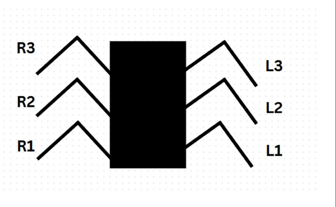

# Hexapod Robot for Terrain Navigation (Platform Summary)

An overview of the six-legged robot I designed for terrain navigation and legged-locomotion research. The robot has a 3D-printed polycarbonate frame, coxa–femur–tibia legs, and support for both 12- and 18-servo builds. It is the mechanical base for the [Ant Bot bio-inspired navigation](https://github.com/adithya2204/bio-inspired-hexapod-navigation) project.

The CAD files and the full design report are in a private repository.

---

## Platform

| Item | Details |
|---|---|
| Frame | Polycarbonate, FDM 3D-printed, chosen for strength and impact resistance |
| Legs | Six legs, each with coxa, femur and tibia segments |
| 18-servo build | 3 DoF per leg: forward/back, up/down and a twisting joint. Enough to step over obstacles and handle rough ground. |
| 12-servo build | 2 DoF per leg: forward/back and up/down. Simpler, for flat ground. |
| Kinematics | Geometric inverse kinematics per leg, with forward kinematics from Denavit–Hartenberg parameters |
| Actuator sizing | Static torque balance in the tripod stance, used to choose the servos |

### Structural layout

---

## Gaits

| Gait | Pattern | Use |
|---|---|---|
| Tripod | R1, R3 and L2 move together, then L1, L3 and R2. Three feet always on the ground. | Fast walking on fairly flat ground |
| Wave | One leg at a time: R1, L1, R2, L2, R3, L3 | Slowest but most stable, for inclines and rough terrain |

The gaits were run on the physical robot. The navigation research uses the robot's Gazebo model.

---

## Applications

- Legged locomotion and gait research
- Terrain-adaptive mobility
- Autonomous navigation in cluttered or uneven environments
- Disaster response: carrying supplies across rubble and stairs

## Related

- [bio-inspired-hexapod-navigation](https://github.com/adithya2204/bio-inspired-hexapod-navigation): Ant Bot, bio-inspired navigation on this platform (ROS 2, Gazebo)

---

## Author

**Adithya Pothula**, Robotics Researcher (Legged Systems and Autonomous Navigation)
Hexapod design by Adithya Pothula and Aryan Duge, Amrita Vishwa Vidyapeetham

GitHub: [adithya2204](https://github.com/adithya2204) · [Google Scholar](https://scholar.google.com/citations?hl=en&user=NI9WpkQAAAAJ)
